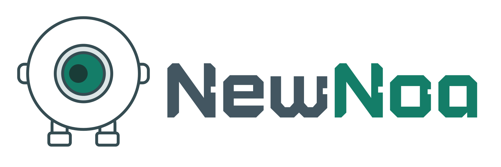

<p align="center">
  <a href="https://newnoa.com">
    <picture>
      <source media="(prefers-color-scheme: dark)" srcset="./assets/newnoa-logo-dark.svg">
      <source media="(prefers-color-scheme: light)" srcset="./assets/newnoa-logo-light.svg">
      
    </picture>
  </a>
</p>

---

<h1 align="center">MaaS · Model as a Service</h1>

<p align="center"><strong>模型即服务</strong></p>

<h3 align="center">让你随时随地用上自己的模型</h3>

<p align="center">
  连接家中的模型与算力，远程使用、分享给朋友，也能接入日常应用。
</p>

<p align="center">
  <strong>远程连接 · 公益模型 · 授权分享 · 协议兼容</strong>
</p>

<h3 align="center">🌐 官方网站：<a href="https://newnoa.com">newnoa.com</a></h3>

<p align="center">
  <strong>简体中文</strong> | <a href="./README_en.md">English</a>
</p>

<p align="center">
  <a href="#introduction">项目介绍</a> ·
  <a href="#scenarios">适合哪些场景</a> ·
  <a href="#capabilities">核心能力</a> ·
  <a href="#getting-started">快速使用</a> ·
  <a href="#usage-notes">使用说明</a> ·
  <a href="#open-source">开源范围</a> ·
  <a href="#roadmap">未来规划</a> ·
  <a href="#contact">联系我们</a> ·
  <a href="#acknowledgments">致谢</a>
</p>

---

<a id="introduction"></a>

## ✨ 项目介绍

你可能已经在家里的显卡主机或工作站上部署了大模型，也调好了喜欢的微调版本、量化方案和推理配置。

但出了家门，想继续使用它，却被没有公网 IP、复杂的网络配置和额外的服务器费用拦住了。

> **NewNoa，让模型走出局域网，让已有算力发挥更多价值。**

模型继续运行在你的设备上。通过 NewNoa，你可以远程调用自己的模型，授权给朋友、同事和合作伙伴使用，也可以把模型接入支持兼容接口的工具、脚本和应用。

没有自己的显卡主机，也可以从公益模型开始。NewNoa 长期提供公益小模型，并提供每日可领取的免费积分额度，降低个人日常使用模型的成本。

<a id="scenarios"></a>

## 适合哪些场景

| 你的需求 | NewNoa 能带来什么 |
| --- | --- |
| 外出时也想使用家里的模型 | 在没有公网 IP 的情况下连接自有模型服务 |
| 想使用自己或他人微调、量化的模型 | 按需选择模型版本、量化方案和推理配置 |
| 自己部署的模型很快，希望充分利用 | 将已经优化好的提示词处理速度（Prefill）和生成速度（Decode）用于远程调用 |
| 简单任务不想每次都调用大模型 | 根据任务选择 4B、9B，甚至不足 1B 的小模型，减少不必要的计算和开销 |
| 需要对话之外的专用模型 | 面向语音识别（ASR）、决策判断、推荐等专用推理场景 |
| 想让亲朋好友共同使用模型 | 授权分享，并了解相应的调用情况和用量 |
| 想把模型接入自动化和智能设备 | 通过服务模式，为具备模型调用能力的程序和设备提供模型接口 |

<a id="capabilities"></a>

## 核心能力

### 远程连接自己的模型

NewNoa 提供免费使用方式，帮助你在没有公网 IP 的情况下远程访问自有模型，无需为了这一用途另外租用一台公网服务器。

只要部署模型的主机保持开机、联网，模型服务正常运行，就可以通过 NewNoa 从外部访问。

### 公益小模型与每日免费积分

不是每个任务都需要庞大的模型。分类、决策、推荐、语音识别和简单文本处理等场景，可以根据实际需求选择合适的小模型。

NewNoa 长期提供公益小模型，并提供每日可领取的免费积分额度，让更多个人用户能够低成本使用 AI。具体额度和可用模型以平台规则为准。

### 分享模型，让闲置算力发挥作用

你可以将自己的模型授权给朋友、同事和合作伙伴使用，并查看分享后的调用记录与用量。

如果愿意向更多人开放，也可以申请公开模型。通过审核并开放服务后，可以按照平台规则获得积分回报。

### 接入工具、应用与智能设备

NewNoa 提供 OpenAI、Anthropic 兼容接口，减少接入现有工具和应用时的适配工作。在支持的接口与模型能力范围内，无需自行搭建额外的协议转换服务。

通过服务模式，局域网内具备模型调用能力的智能家电、自动化程序和其他应用，也可以接入模型。调用记录可以帮助你了解它们向模型发送了什么请求、模型返回了什么，以及消耗了多少资源。

### 调用记录与用量留存

NewNoa 可以帮助你保存调用记录、统计用量，并支持以下数据库：

**SQLite · PostgreSQL · MySQL · MongoDB**

需要云端保存和同步时，也可以选择相应的付费服务。记录保留期限按所选存储方式和服务方案执行。

### 根据网络环境选择连接路径

NewNoa 结合 FRP 中继与基于 EasyTier 的 STUN / NAT 穿透能力，通过 Go Server 节点的延迟检测选择合适的连接路径。

能够直连时使用直连，无法直连时通过中继访问。实际连接效果取决于双方网络环境；中继带宽和并发额度按服务方案执行。

<a id="getting-started"></a>

## 🚀 快速使用

### 客户端

开箱即用，下载并安装客户端即可开始使用。

- **普通版**：面向中国大陆用户，仅支持中国模型。
- **国际版**：面向中国大陆以外地区，支持全球模型，并提供平台当前已上线的完整功能。

国际版根据访问 IP 的地理位置判定服务区域，不向中国大陆地区提供服务。

[前往 Releases 下载客户端](https://github.com/)

### 服务模式 · Docker

已安装 Docker 的用户，可以通过以下命令启动服务模式：

```bash
docker run -d \
  -p 6060:6060 \
  -p 18222:18222 \
  -v /yourpath:/data \
  newnoa/newnoa-maas-docker:latest
```

启动后，在浏览器打开 **`http://localhost:6060`**；从其他设备访问时，将 `localhost` 替换为 Docker 宿主机的局域网 IP。

- **网页入口：`6060`**；**模型 API 代理：`18222`**。如需通过映射端口调用模型，请在页面启用代理的局域网访问，并使用宿主机地址。
- 将 **`/yourpath`** 替换为实际的数据存储目录，并确保容器用户 **UID 1000** 可以读写。调用记录与导出数据保存在 `/data`。

> Releases 链接暂为占位；示例镜像以实际发布为准，后续补充正式下载地址与部署文档。

没有自己的模型，也可以从平台提供的公益模型开始。访问 [newnoa.com](https://newnoa.com) 了解更多。

<a id="usage-notes"></a>

## 使用说明

- **自有设备需要保持在线。** NewNoa 提供连接与调用能力，模型推理仍由部署模型的设备完成；实际速度受设备性能、模型配置和网络条件共同影响。
- **免费使用有明确范围。** 每日公益积分、免费方案的带宽和并发等按平台规则执行；云端存储等增值服务另行收费。
- **兼容范围以实际支持为准。** 不同模型提供的能力和接口有所不同，不能仅凭协议名称判断所有功能都可互通。
- **调用记录有保留期限。** SQLite 调用记录固定保留最近 7 天，其他数据库和云端存储按各自规则执行；需要长期留存时，请选择适合的存储方式。

<a id="open-source"></a>

## 开源范围

NewNoa 已开源 **Go Core** 与 **Go Server**，希望与社区一起完善模型连接、网络穿透与服务转发能力。

- **Go Core**：负责本地模型接入、代理转发与连接管理。
- **Go Server**：负责服务节点侧的模型转发、授权校验与网络连接协作。

具体使用与再分发条件以各组件仓库中的许可证和第三方声明为准。

<a id="roadmap"></a>

## 未来规划

- [ ] 图片生成模型支持
- [ ] 视频生成模型支持
- [ ] ComfyUI 工作流支持

以上为后续规划，具体能力和开放时间以实际发布为准。

---

<p align="center">
  <strong>从自己用，到分享给朋友，再到接入日常应用。</strong><br>
  让你已经拥有的模型，多一些用武之地。
</p>

<p align="center">
  <a href="https://newnoa.com">newnoa.com</a>
</p>

<a id="contact"></a>

## 💬 联系我们

NewNoa 以公司主体运营，目前由一人独立开发和维护。我们希望通过持续提供公益模型，让更多个人用户以更低的成本使用 AI。

如果你是愿意提供**公益模型支持**的个人、团队或机构，欢迎联系我们，一起让更多模型与算力服务于有需要的人。

**微信（WeChat）：`newnoa`**

<a id="acknowledgments"></a>

## 🙏 致谢

NewNoa 的开发受益于开源社区的积累。感谢以下项目的作者、维护者与贡献者，为模型接入、代理服务和网络连接提供了优秀的实现与设计参考。

| 项目 | 致谢说明 |
| --- | --- |
| [CC Switch](https://github.com/farion1231/cc-switch) | 为模型服务配置、接入管理与使用体验提供参考。 |
| [Magpie](https://github.com/yetone/magpie) | 为模型代理、流式响应处理与连接可靠性等设计提供参考。 |
| [LiteLLM](https://github.com/BerriAI/litellm) | 为多模型服务接入、协议适配与用量处理提供研究和设计参考。 |
| [gofrp / FRP](https://github.com/fatedier/frp) | 为内网穿透与中继连接提供基础能力。 |
| [EasyTier](https://github.com/EasyTier/EasyTier) | 为 NAT 穿透、点对点连接与虚拟网络提供基础能力。 |

感谢每一位推动开源发展的贡献者。各项目的名称与代码权利归原权利人所有，实际使用或再分发的第三方组件遵循各自许可证。
