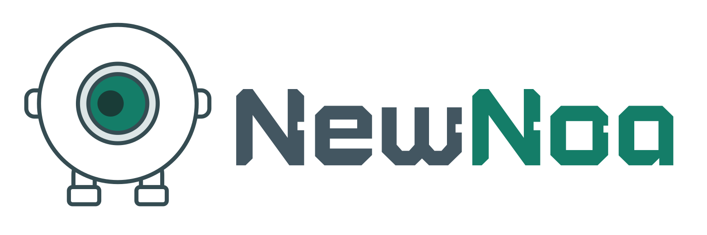
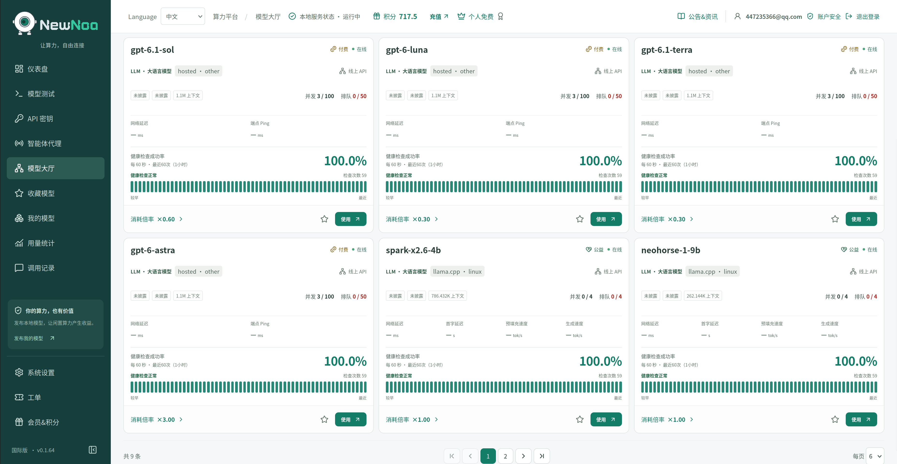
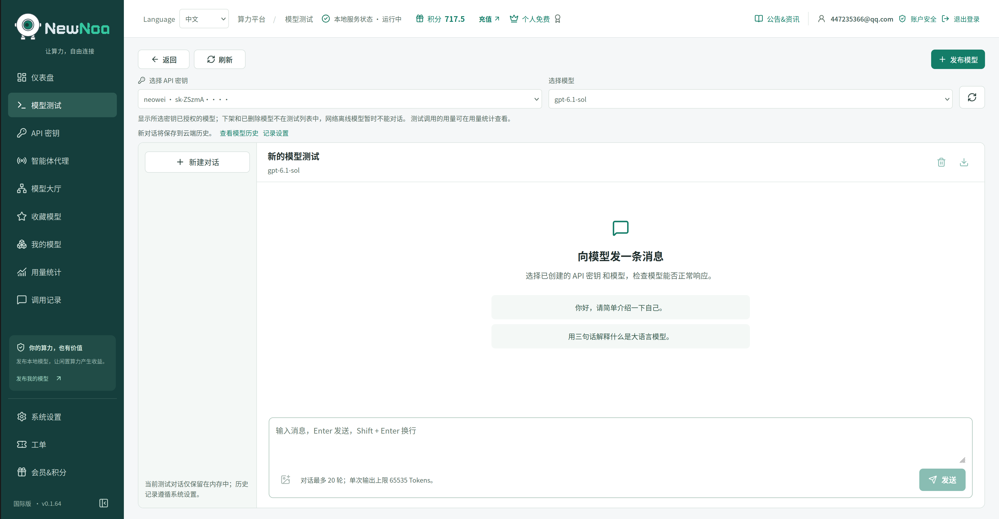
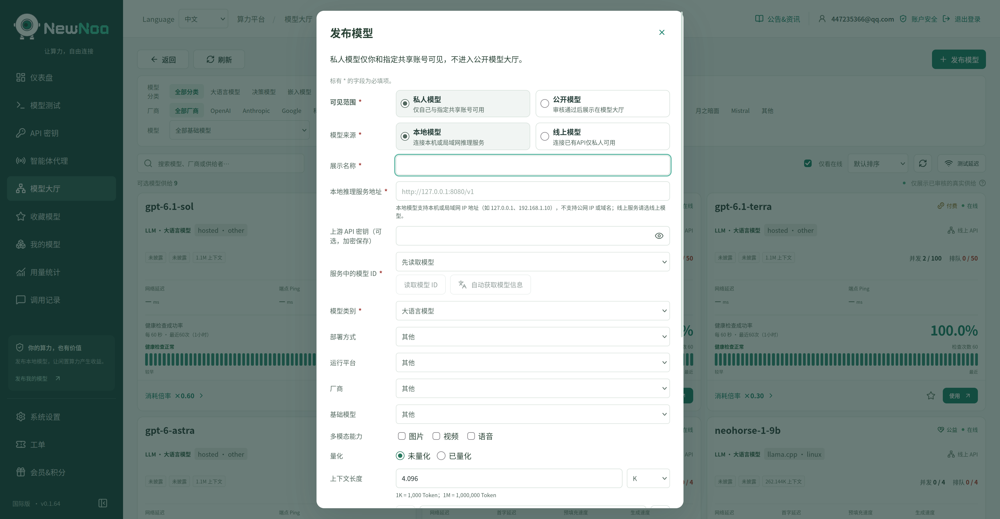
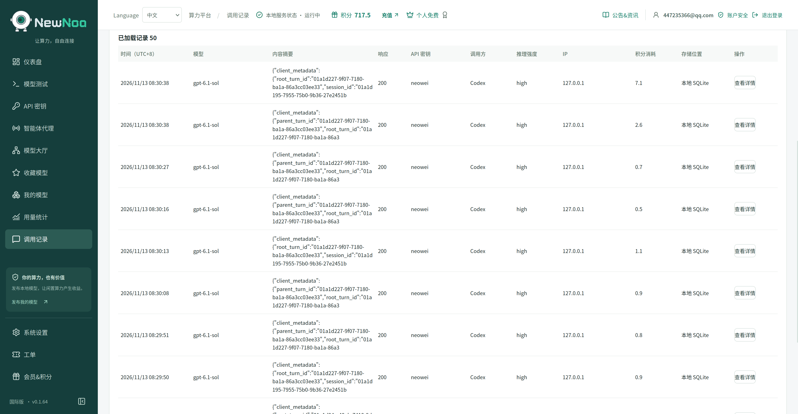

<p align="center">
  <a href="https://newnoa.com">
    <picture>
      <source media="(prefers-color-scheme: dark)" srcset="./assets/newnoa-logo-dark.svg">
      <source media="(prefers-color-scheme: light)" srcset="./assets/newnoa-logo-light.svg">
      
    </picture>
  </a>
</p>

---

<h1 align="center">MaaS · Model as a Service</h1>

<h3 align="center">Use your own models, wherever you are</h3>

<p align="center">
  Connect the models and compute you already own. Access them remotely, share them with friends, and use them in everyday applications.
</p>

<p align="center">
  <strong>Remote access · Community models · Authorized sharing · Compatible APIs</strong>
</p>

<h3 align="center">🌐 Official website: <a href="https://newnoa.com">newnoa.com</a></h3>

<p align="center">
  <a href="./README.md">简体中文</a> | <strong>English</strong>
</p>

<p align="center">
  <a href="#introduction">Introduction</a> ·
<a href="#screenshots">Screenshots</a> ·
  <a href="#scenarios">Use cases</a> ·
  <a href="#capabilities">Capabilities</a> ·
  <a href="#getting-started">Quick start</a> ·
  <a href="#usage-notes">Usage notes</a> ·
  <a href="#open-source">Open source</a> ·
  <a href="#roadmap">Roadmap</a> ·
  <a href="#contact">Contact us</a> ·
  <a href="#acknowledgments">Acknowledgments</a>
</p>

---

<a id="introduction"></a>

## ✨ Introduction

You may already run a language model on a GPU PC or workstation at home, with the fine-tuned version, quantization, and inference settings you prefer.

But when you leave home, the lack of a public IP address, complicated network configuration, and extra server costs can get in the way.

> **NewNoa brings your models beyond your local network and helps you put existing compute to work.**

Your models keep running on your own devices. With NewNoa, you can access them remotely, authorize friends and colleagues to use them, and connect them to tools, scripts, and applications that support compatible APIs.

You can also get started without a GPU machine of your own. NewNoa offers community small models and a daily allowance of free credits to help reduce the cost of personal AI use.

<a id="screenshots"></a>

## Screenshots

Click a screenshot to view the full-size image.

<table>
  <tr>
    <td align="center" width="50%">
      <a href="./assets/screenshots/model-catalog.png"></a>
      <br>
      <strong>Model catalog</strong>
    </td>
    <td align="center" width="50%">
      <a href="./assets/screenshots/model-testing.png"></a>
      <br>
      <strong>Model testing</strong>
    </td>
  </tr>
  <tr>
    <td align="center" width="50%">
      <a href="./assets/screenshots/publish-model.png"></a>
      <br>
      <strong>Publish a model</strong>
    </td>
    <td align="center" width="50%">
      <a href="./assets/screenshots/call-records.png"></a>
      <br>
      <strong>Call records</strong>
    </td>
  </tr>
</table>

<a id="scenarios"></a>

## Use cases

| What you need | How NewNoa helps |
| --- | --- |
| Use your home models while away | Connect to your own model services without a public IP address |
| Choose fine-tuned or quantized models | Use the model versions, quantization, and inference settings that suit your needs |
| Make more use of a fast local deployment | Access your optimized prefill and decode performance remotely |
| Avoid large models for simple tasks | Choose 4B, 9B, or even sub-1B models where appropriate to reduce unnecessary compute and cost |
| Use specialized models beyond chat | Support scenarios such as automatic speech recognition (ASR), decision-making, and recommendations |
| Share models with friends and colleagues | Authorize access and track the associated calls and usage |
| Connect automation and smart devices | Use service mode to provide model APIs to programs and devices that can call them |

<a id="capabilities"></a>

## Capabilities

### Access your own models remotely

NewNoa offers a free option for remotely accessing your own models without a public IP address or renting a separate public server for this purpose.

Keep the host powered on, connected to the internet, and running a working model service to access it through NewNoa from elsewhere.

### Community small models and daily free credits

Not every task needs a large model. Classification, decisions, recommendations, speech recognition, and simple text processing can often use smaller models chosen for the task.

NewNoa offers community small models and a daily allowance of free credits to make personal AI use more affordable. Available models and credit allowances follow the platform's current rules.

### Share models and put idle compute to work

Authorize friends, colleagues, and collaborators to use your models, and review the resulting call records and usage.

You can also apply to make a model publicly available. Once approved and serving users, it can earn platform credits under the applicable rules.

### Connect tools, applications, and smart devices

NewNoa provides OpenAI-compatible and Anthropic-compatible APIs to reduce integration work. Within the supported API and model capabilities, you do not need to set up a separate protocol translation service yourself.

Service mode also lets applications, automation programs, and smart devices on your local network connect to models, provided they can make model API calls. Call records help you understand what they sent to the model, what the model returned, and how many resources each call used.

### Keep call records and usage data

NewNoa can save call records and track usage with the following databases:

**SQLite · PostgreSQL · MySQL · MongoDB**

Paid cloud storage and synchronization options are also available. Retention periods depend on the storage method and service plan you choose.

### Choose a connection path for your network

NewNoa combines FRP relaying with EasyTier-based STUN / NAT traversal, using Go Server latency checks to select a suitable connection path.

Direct connections are used when possible, with relaying available when a direct connection cannot be established. Results depend on both sides' network conditions. Relay bandwidth and concurrency allowances follow the selected service plan.

<a id="getting-started"></a>

## 🚀 Quick start

### Desktop client

Download and install the client to get started out of the box.

- **Standard edition**: For users in mainland China, with access to Chinese models only.
- **International edition**: For users outside mainland China, with access to models from around the world and the platform's full set of currently released features.

The international edition determines service availability by the geographic location of the accessing IP address and does not provide service to mainland China.

[Download the client from Releases](https://github.com/)

### Service mode · Docker

With Docker installed, start service mode using:

```bash
docker run -d \
  -p 6060:6060 \
  -p 18222:18222 \
  -v /yourpath:/data \
  newnoa/newnoa-maas-docker:latest
```

Open **`http://localhost:6060`** in your browser. To connect from another device, replace `localhost` with the Docker host's LAN IP address.

- **Web interface: `6060`**; **model API proxy: `18222`**. To call models through the published port, enable LAN access for the proxy in the web interface and use the host address.
- Replace **`/yourpath`** with your actual data directory and ensure that container user **UID 1000** can read and write it. Call records and exports are stored in `/data`.

> The Releases link is a placeholder. Image availability is subject to actual publication; official download links and deployment documentation will be added later.

If you do not have your own model, start with the platform's community models. Visit [newnoa.com](https://newnoa.com) to learn more.

<a id="usage-notes"></a>

## Usage notes

- **Your host must stay online.** NewNoa provides connectivity and model access; inference still runs on the device hosting the model. Actual performance depends on hardware, model settings, and network conditions.
- **Free usage has defined limits.** Daily community credits, free-plan bandwidth, and concurrency follow platform rules. Additional services such as cloud storage are paid options.
- **Compatibility depends on supported capabilities.** Models expose different APIs and features. A shared protocol name does not guarantee that every feature is interchangeable.
- **Call records have retention periods.** SQLite retains the most recent seven days of call records. Other databases and cloud storage follow their respective retention rules. Choose a suitable storage option if you need longer retention.

<a id="open-source"></a>

## Open source

NewNoa has open-sourced **Go Core** and **Go Server** to work with the community on model connectivity, network traversal, and request forwarding.

- **Go Core** handles local model access, proxy forwarding, and connection management.
- **Go Server** handles model forwarding, authorization checks, and network connection coordination on service nodes.

Use and redistribution are subject to the licenses and third-party notices in each component's repository.

<a id="roadmap"></a>

## Roadmap

- [ ] Image generation model support
- [ ] Video generation model support
- [ ] ComfyUI workflow support

These are planned capabilities. Availability and release dates depend on actual releases.

---

<p align="center">
  <strong>Use your models yourself, share them with friends, and connect them to everyday applications.</strong><br>
  Put the models you already own to more uses.
</p>

<p align="center">
  <a href="https://newnoa.com">newnoa.com</a>
</p>

<a id="contact"></a>

## 💬 Contact us

NewNoa is operated through a company and is currently developed and maintained by one person. We aim to keep offering community models so that more people can use AI at a lower cost.

If you are an individual, team, or organization willing to **support our community model offering**, we would love to hear from you. Together, we can make more models and compute available to people who need them.

**WeChat: `newnoa`** · **Email: <newnoa@newnoa.com>**

<a id="acknowledgments"></a>

## 🙏 Acknowledgments

NewNoa benefits from the work of the open-source community. We thank the authors, maintainers, and contributors of the following projects for their implementations and design references in model access, proxy services, and networking.

| Project | Contribution or inspiration |
| --- | --- |
| [CC Switch](https://github.com/farion1231/cc-switch) | References for model service configuration, access management, and usability. |
| [Magpie](https://github.com/yetone/magpie) | References for model proxies, streaming response handling, and connection reliability. |
| [LiteLLM](https://github.com/BerriAI/litellm) | Research and design references for model service integration, protocol adaptation, and usage handling. |
| [gofrp / FRP](https://github.com/fatedier/frp) | Foundational capabilities for network traversal and relayed connections. |
| [EasyTier](https://github.com/EasyTier/EasyTier) | Foundational capabilities for NAT traversal, peer-to-peer connectivity, and virtual networking. |

Thank you to everyone who contributes to open source. Project names and code rights belong to their respective owners. Third-party components used or redistributed by NewNoa remain subject to their own licenses.
